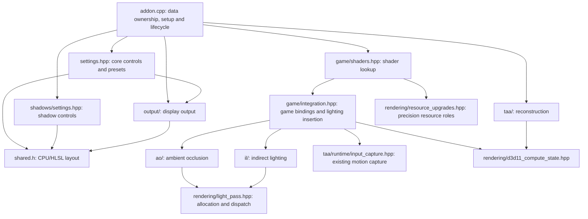

# MGSV rendering structure

This describes the first structural cleanup of the mod. It groups code by responsibility without changing shaders, GI history behavior, effect defaults, resource formats, or insertion order. It does not yet make game input capture independent of reconstruction.

## Foundation, inputs, effects, output

High-precision resources are the shared rendering foundation. They are not owned by HDR output, TAA, AO, or GI. The game reuses textures for different purposes, so upgrades still need pass-specific identification and activation. An upgraded texture does not by itself prove that its contents are current or suitable for a particular effect.

The current source dependencies are:

These arrows are dependencies, not a GPU timeline. The integration-to-TAA-capture edge is deliberately still present. GI receives a velocity view as an argument instead of reading another feature's storage directly, but the integration callback currently obtains it from the same old capture cache.

The extraction moves that borrowed velocity-handle read to the GI call boundary; it previously occurred inside GI after gather recording. No new lifetime or freshness guarantee accompanies the earlier read. This unresolved timing boundary matters when GI runs and belongs in the input-ownership work, not a claim of exact runtime equivalence.

## Owners and interfaces

| Owner | Owns | Does not establish |
|---|---|---|
| `addon.cpp` | One stable `ShaderInjectData`, output state, assembled settings and shader registries, event adapters | A synchronized snapshot of every writer |
| `mgsv::settings` | Core descriptor definitions, Reset All and Preset Off policy; operates on supplied storage and registry | Feature control definitions or a second copy of shader values |
| `mgsv::shadows` | Contact-hardening and screen-space-shadow descriptor definitions | Scene capture or separate shader storage |
| `mgsv::output` | Output-state type, output-value synchronization and initial peak detection; operates on supplied state | The core settings registry, precision upgrades or lighting history |
| `mgsv::rendering::resource_upgrades` | Stable role descriptors, original/clone checks, DoF/motion copy tracking and callbacks, velocity target preparation | Clone allocation ownership, thread-safe copy tracking, or which scene a cached input belongs to |
| `mgsv::rendering` | Lighting layout, fallback textures, allocation/dispatch support and logging | AO/GI feature settings or a general renderer |
| `mgsv::rendering::d3d11_compute_state` | Existing compute/graphics state snapshot and restoration | GPU completion; `Capture` also unbinds output-merger targets |
| `mgsv::game` | Shader registrations, borrowed material-view handles, scatter binding checks, explicit IL-then-AO calls | Retention or freshness of cached material and velocity views |
| `mgsv::ao` | AO factor texture, optional depth chain and calculation/application passes | Temporal history |
| `mgsv::il` | Gather, history, geometry-history, moments, denoise and final-add resources | A new history/reset algorithm; the old behavior remains |
| `taa` | Existing reconstruction methods, capture, camera/jitter policy, submission bridge and SDK lifetimes | Independent GI motion capture when reconstruction is Off |

AO and GI receive a copy of `ShaderInjectData` for each call and apply their local overrides to that copy. GI also receives the existing velocity view. Their settings builders receive the shader storage to bind explicitly; visibility callbacks capture that pointer by value. `shared.h` remains the one CPU/HLSL layout, with the same fields, order and b13 binding. There is no second settings buffer and no module framework.

### Allocation and lifetime

- AO and GI own their feature textures and pipelines. `rendering/light_pass.hpp` creates and destroys them on request; it owns only the shared layout and placeholder textures. The state is still module-global, not a per-device resource collection. `addon.cpp` destroys AO, GI, the shared layout and placeholders in that order on device destruction.
- The shared RenoDX resource machinery owns clone allocations and resource/view records. `resource_upgrades.hpp` owns MGSV's role descriptors and activation rules, not the clone textures themselves. Descriptor addresses identify roles and must stay stable. The one-time LUT upgrade registration still occurs in `addon.cpp`.
- The lighting callback retains native depth, normal, source-light and output-light views until it returns. The material cache stores only borrowed handles. TAA capture owns its velocity SRV, but the GI call receives only a borrowed handle without TAA's capture validation. None of these handles proves when the texture contents were written.
- `addon.cpp` owns shader data, output state and the registry before constructing their callbacks. On attach it appends core, shadows, reconstruction, AO and GI controls, then hands the complete registry to the settings utility. Shadow/AO/GI insertion before Options retains the previous UI order. Core settings populate the output state's borrowed brightness descriptors before output synchronization or swapchain callbacks can run.
- A registry remains bound to its original storage. Core/shadow/AO/GI append functions detect repeated assembly within that registry rather than using process-wide append flags. Their borrowed shader/output pointers and the registry must outlive callbacks and must not move after assembly. Independent descriptor registries do not create independent AO/GI runtimes: the AO CPU depth-mip switch and GPU resources remain feature-owned globals.
- Reset All and Preset Off update their supplied registry with the existing settings write lock, without selecting the utility's global registry or invoking UI callbacks. Preset Off remains a core policy across features and leaves reconstruction selection alone. TAA's append operation still migrates persisted settings; separating that existing side effect is not part of this cleanup.
- `game::CreateShaders` captures the addon-owned shader data for the scatter callback. Integration observes it by const reference and each effect takes its own value copy at the same point as before. This makes storage ownership explicit without claiming a coherent snapshot across concurrent writers.

The registry maps game shader hashes to callbacks; the resource-upgrade module handles clone activation and copy tracking. The deferred callback still combines two responsibilities intentionally: upgrade scene color, then remember the material bindings. These operations must remain in that order.

Headers are included at file scope and declare their intended namespaces. No feature depends on being textually included inside `addon.cpp`'s anonymous namespace. The addon entry still includes ImGui before ReShade, as required for ReShade's UI function table; this is a separate SDK include-order requirement.

## Current pass placement

At the second lighting-scatter callback, the original dispatch is recorded first. The callback retains its depth, normal, light-source and light-output views, records GI if eligible, records AO if enabled, then restores the surrounding state. The callback records GPU commands; recording does not mean the GPU has executed or completed them.

| Stage | Inputs | Output |
|---|---|---|
| GI gather | Depth, normal, source light, albedo, specular light | Bounce radiance and sample validity |
| GI accumulation | Bounce, velocity, old radiance/geometry/moments | Next history, filter input, geometry history, moments |
| GI denoise | Accumulated radiance, depth, normal, moments | Alternating filtered textures, 1–3 iterations |
| GI add | Last denoise result and depth | Added RGB in the existing light buffer; alpha retained |
| AO calculation | Depth, normal, optional lower-resolution depth | Separate visibility texture |
| AO application | Visibility and depth | Darkened RGB in the existing light buffer; alpha retained |

The native geometry constants at b0 are still borrowed from the game. The mod supplies its own per-pass values at b13. IL before AO is intentional: AO darkens the combined direct and added light. Feature toggles are independent controls; arbitrary internal-stage order is not supported.

Reconstruction keeps its existing separate insertion rules and deferred submission handling. This cleanup does not move GI to that submission system or change when GI advances its history index.

## What remains unchanged

- Every shader source and the shared CPU/HLSL layout remain unchanged. The tested history-reuse and edge behaviors are intentionally not fixed in this structural step.
- The existing settings, defaults, keys, UI order, and Preset Off values are retained. Preset Off still leaves reconstruction separately controlled.
- The existing copy gates, original/clone checks, resource formats, fallback UAV separation, and lifecycle/event order are retained.
- Velocity preparation still follows the old temporal-enable gate. Its implementation now belongs to the common precision module, but removing the gate is a separate behavior change.
- Native camera hooks, DLL/SDK activation, DLSS suspension, and vendor code remain in their existing ownership and namespaces.
- Shader registrations keep the same explicit-entry order and generated entries. This step does not change duplicate-key precedence. `on_inject=false` prevents constant injection; it is not a shader-replacement switch.

The generated first-scatter entry has replacement code and the explicit second-scatter entry is callback-only. Older descriptions saying both original shader bytecodes remain bound are too broad. This cleanup preserves the actual registrations rather than changing them to match that wording.

## Remaining ownership and validation work

1. Share motion acquisition and qualification independently of reconstruction selection. Passing a raw view explicitly is the first dependency cleanup, not a freshness or lifetime guarantee.
2. Separate baseline precision activation from effect enablement, validating native motion consumers and both output modes before changing the current gates.
3. Give material inputs, resource generations and history submission explicit ownership. Retaining an object does not freeze its pixels; a CPU lock does not establish GPU order.
4. Establish a coherent settings snapshot across settings, output, temporal and random writers.
5. Address the measured GI history/edge issues in separate, narrowly tested changes only when requested. Do not repeat the failed blanket history-rejection/clearing or RG32F-moments experiment.
6. Verify game producer order, cold-start GI with reconstruction Off, transitions and visual stability in MGSV before changing these boundaries.

The detailed mathematical and historical notes remain with each feature. API checks and shader readback do not substitute for game-specific execution evidence. Local development tests are not part of the addon or its build dependencies.

## Performance work needs separate evidence

`LightPass` currently recreates a pipeline when effect dimensions change even though pipeline creation does not use those dimensions. That is a candidate for reducing rebuilds, not a change made here. State preservation also reads many native binding slots; reducing that coverage requires proving which bindings added compute work can displace. Neither optimization should be bundled with input ownership or GI history changes. The structural cleanup makes no claim of improved frame time.

## Reconstruction validation boundary

Analytical TAA, FSR and DLSS require validation through the game's temporal submission path. An earlier manual comparison showed waveform instability with DLSS Preset M, not with FSR after switching, and not clearly with Preset F; a later smoke test appeared to work normally. These observations do not establish a model defect, a refactor regression or a stability fix. Reconstruction diagnostics and any changes to input ownership, jitter, history or submission belong in separate work; no such fix is included in this structural cleanup.