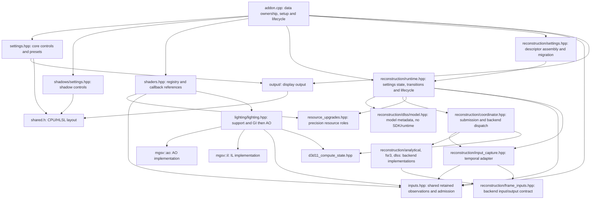

# MGSV rendering structure

This describes current source ownership, not a completed independent-GI implementation. Root `inputs.hpp` owns retained native motion and materials independently of reconstruction. Identified velocity precision preparation runs before reconstruction-enable and descriptor-data returns under the existing execution guard. GI reads a retained compatibility selection, not reconstruction storage; newly observed Off+GI motion does not change that selection. Qualified GI handoff remains **BLOCKED** on the live producer chain and the cold-history defect. Shader/history algorithms, defaults, settings order, SDK activation timing and registry precedence are unchanged.

## Current source layout

The consolidation reduced authored MGSV `.cpp`/`.hpp` files from 27 to 24; the new root input owner brings the current count to 25, excluding the FSR vendor subtree. Obsolete copies under the old `ao/`, `il/`, `game/` and `rendering/` roots are removed. Shared lighting support, AO, IL and their post-scatter orchestration form one implementation module; the reconstruction draw adapter lives with its runtime. There are no forwarding replacements or renderer framework.

| Path relative to the mod root | Responsibility |
|---|---|
| `addon.cpp` | Stable shader/settings/output storage, registry assembly, utility setup, shared descriptor/draw registrations and lifecycle/event composition |
| `inputs.hpp` | Shared descriptor tracking, retained `Motion`/latest and `lighting_motion` compatibility selections, `Materials`, first-present single-device/swapchain admission, generations and publication tickets |
| `shaders.hpp` | Shader registry and callback references; `mgsv::game::CreateShaders` keeps its existing API |
| `lighting/lighting.hpp` | Shared lighting layout, targets, pipelines, fallbacks and logs; admitted `ApplyLightPasses` reads retained shared inputs; AO and IL implementations/settings remain in `mgsv::ao` and `mgsv::il` |
| `resource_upgrades.hpp` | Mod-wide resource roles, velocity-producer identification, clone activation and copy windows; namespace `mgsv::rendering::resource_upgrades` |
| `d3d11_compute_state.hpp` | Shared native state preservation; namespace `mgsv::rendering::d3d11_compute_state` |
| `reconstruction/runtime.hpp` | Settings state, transitions, lifecycle, and merged draw routing in the unchanged `mgsv::game::reconstruction` namespace |
| `reconstruction/input_capture.hpp` | Retained motion adapter with camera/frame/sample annotations and insertion-time matching dimensions, single mip/layer/sample validation |
| `reconstruction/frame_inputs.hpp` | Backend input/output contracts and shared 96-byte `PrepareConstants` |
| `reconstruction/prepare_inputs.hlsli`, `reconstruction/encode_output.hlsli` | Shared SDK adapter math; backend entry shaders and SDK resources remain distinct |
| `lighting/ao/`, `lighting/il/` | AO/IL shader sources and feature research notes; shader basenames unchanged |

Heavy backend implementations, SDK lifetimes, native hooks, and submission coordination remain separate because they own distinct resources, validation rules, and platform dependencies. `reconstruction/frame_inputs.hpp` remains the backend-facing `ValidatedFrameInputs`/`MethodOutput` contract so backends need not include capture implementation or the lifecycle umbrella to name their inputs and outputs. `reconstruction/dlss/model.hpp` remains a pure metadata header with no SDK/runtime dependency. No forwarding headers or namespace aliases replace the removed files.

The temporal support headers are flat beside `reconstruction/runtime.hpp`, and the FSR vendor subtree remains intact under `reconstruction/fsr3/ffx/`. The Analytical resolve shader lives in `reconstruction/analytical/`. Native velocity shaders live in `motion/`, scatter ports and `ssss.hlsli` in `subsurface/`, copy shaders in `copy/`, GammaControl in `output/`, reflections in `reflections/`, and rain materials in `gbuffer/`. The old `game/`, `rendering/`, `ao/` and `il/` root directories are removed; namespace names need not mirror physical paths. Historical engine and shader research remains in `docs/` with its attribution intact.

## Foundation, inputs, effects, output

High-precision resources are the shared rendering foundation. They are not owned by HDR output, TAA, AO, or GI. The game reuses textures for different purposes, so upgrades still need pass-specific identification and activation. An upgraded texture does not by itself prove that its contents are current or suitable for a particular effect.

The current source dependencies are:

These arrows are source dependencies and access relationships, not a GPU timeline or a complete include graph. `lighting::ApplyLightPasses` pins a shared snapshot and passes `lighting_motion.velocity` to GI for the callback lifetime. It no longer reads reconstruction capture storage. This retained compatibility path does not apply reconstruction's temporal validation or qualify GI contents.

The root owner separates latest observation from compatibility selection. Effective reconstruction capture may publish both; Off+GI capture updates latest only, and creation failure can retire only that latest selection. Off+GI capture must never replace or clear `lighting_motion`. Missing bindings preserve existing selections. Retention preserves objects, not pixel contents, freshness, producer completion or GPU execution order.

## Owners and interfaces

| Owner | Owns | Does not establish |
|---|---|---|
| `addon.cpp` | One stable `ShaderInjectData`, output state, reconstruction CPU preferences, assembled settings and shader registries, event adapters | A synchronized snapshot of every writer |
| `mgsv::settings` | Core descriptor definitions, Reset All and Preset Off policy; operates on supplied storage and registry | Feature control definitions or a second copy of shader values |
| `mgsv::shadows` | Contact-hardening and screen-space-shadow descriptor definitions | Scene capture or separate shader storage |
| `mgsv::output` | Output-state type, output-value synchronization and initial peak detection; operates on supplied state | The core settings registry, precision upgrades or lighting history |
| `mgsv::rendering::resource_upgrades` | Stable role descriptors, original/clone checks, DoF/motion copy tracking and callbacks, velocity target preparation | Clone allocation ownership, thread-safe copy tracking, or which scene a cached input belongs to |
| `mgsv::inputs` | Descriptor tracking, retained motion/material snapshots, bounded velocity-view reuse, first-present device/swapchain selection, generation retirement and publication tickets | Frozen pixels, scene identity, freshness or GPU ordering |
| `mgsv::lighting` | Lighting layout, fallback textures, allocation/dispatch support, logging, callback-local retained snapshot, scatter checks and IL-then-AO orchestration | A general renderer, shared input storage or qualified GI motion/history |
| `mgsv::rendering::d3d11_compute_state` | Existing compute/graphics state snapshot and restoration | GPU completion; `Capture` also unbinds output-merger targets |
| `mgsv::game` | Shader registrations and callback composition in root `shaders.hpp` | Lighting implementation or input retention |
| `mgsv::ao` | AO factor texture, optional depth chain and calculation/application passes | Temporal history |
| `mgsv::il` | Gather, history, geometry-history, moments, denoise and final-add resources | A new history/reset algorithm; the old behavior remains |
| `mgsv::game::reconstruction` | MGSV classification, identified precision preparation, demand routing to shared motion capture under the existing execution guard, and temporal insertion routing inside `reconstruction/runtime.hpp` | Shared storage ownership or fresh GI inputs with reconstruction Off |
| `mgsv::reconstruction::settings` | Descriptor assembly, custom selectors and migration; uses supplied registry, preferences and shader storage | Multiple independent runtimes or implicit migration during assembly |
| `mgsv::reconstruction::transitions` | Requested/effective mode synchronization, model/tuning changes and existing reset/lock ordering | A new history policy or new SDK activation timing |
| `mgsv::reconstruction` | Temporal motion adapter, camera/frame/sample validation, reconstruction methods, camera/jitter policy, submission bridge and SDK lifetimes | Shared native observation ownership or qualified independent GI |

AO and GI receive a copy of `ShaderInjectData` for each call and apply their local overrides to that copy. GI also receives the existing velocity view. Their settings builders receive the shader storage to bind explicitly; visibility callbacks capture that pointer by value. `shared.h` remains the one CPU/HLSL layout, with the same fields, order and b13 binding. There is no second settings buffer and no module framework.

### Allocation and lifetime

- AO and GI own their feature textures and pipelines in `lighting/lighting.hpp`; the shared support owns the common layout and placeholder textures. State remains module-global, not a per-device map. The first-present input admission check runs before lighting allocation/dispatch: lighting skips before the first selected Present, on foreign devices and during retirement/resize. Selected-device teardown in `addon.cpp` retires shared inputs before destroying AO, GI, the shared layout and placeholders; foreign teardown does not clear those owners.
- The shared RenoDX resource machinery owns clone allocations and resource/view records. Root `resource_upgrades.hpp` owns MGSV's stable role descriptors, including `lut_builder_upgrade_info` and `velocity_upgrade_info`, and activation rules, not the clone textures themselves. Descriptor addresses identify roles and must stay stable. The one-time LUT upgrade registration still occurs in `addon.cpp`.
- `dof_copy_state`, `motion_blur_copy_state` and `tonemap_copy_state` group the existing role bookkeeping without new ownership or synchronization. Present resets the same flags and source as before; it does not clear the motion-blur resource list. Existing copy-back cleanup remains separate.
- The lighting callback retains native depth, normal, source-light and output-light views and a shared snapshot until it returns. Root `inputs.hpp` owns retained albedo/specular pairs and separate latest/compatibility motion selections; reconstruction retains its own selected motion plus camera/frame/sample annotations. Native getters acquire live references. Motion acquisition explicitly pins enabled producer/object clones under each clone's own live resource-view record, checking device, role and original-resource identity; it does not require exact parity with the previous descriptor-state handles or AddRef an arbitrary prepared handle.
- The owner has no per-context retained cache and no demand-off clearing. Latest motion supplies bounded velocity-SRV reuse by sampled resource and typed format; compatibility and adapter references can retain older selections until replacement, reset or retirement. Generations reject late publication after retirement, and monotonic tickets prevent older/reentrant capture or failed creation from overwriting newer selections. Displaced references are released outside the input metadata lock. None of this freezes contents or synchronizes GPU work.
- Shared motion publication does not reject mismatched depth/object extents before updating GI compatibility. Matching color/velocity/depth/object dimensions and single-mip/layer/sample resource layouts are stricter reconstruction-only checks at insertion; they must not silently narrow compatibility publication. Shared first-present selection also guards reconstruction's Present-time device binding against a competing foreign first Present.
- `addon.cpp` owns shader data, output state, reconstruction preferences and the registry before constructing their callbacks. On attach it appends core, shadows, reconstruction, AO and GI controls, then hands the complete registry to the settings utility. Shadow/AO/GI insertion before Options retains the previous UI order. Core settings populate the output state's borrowed brightness descriptors before output synchronization or swapchain callbacks can run.
- A registry remains bound to its original storage. Core/shadow/reconstruction/AO/GI append functions detect repeated assembly within that registry rather than using process-wide append flags. Their borrowed shader/output/preference pointers and the registry must outlive callbacks and must not move after assembly. Independent descriptor registries do not create independent runtimes: the AO CPU depth-mip switch, reconstruction runtime mirrors and GPU resources remain feature-owned globals.
- Reconstruction `settings::State` in `reconstruction/runtime.hpp` holds float CPU preferences and borrowed mode/model descriptor pointers in stable addon-global storage. `AppendSettings` rejects null arguments, either already-bound descriptor pointer, or a duplicate reconstruction registry key; the same state cannot be bound again, even to another registry. The runtime umbrella includes backend, capture and lifecycle dependencies; only `reconstruction/dlss/model.hpp` is the pure model-metadata header, owning `Model`, model metadata, the default and `FindModelOption` without SDK/runtime dependencies.
- The ten uniform projection controls are assembled from an ordered local descriptor table in `reconstruction/settings.hpp`. Keys, labels, bindings, visibility, defaults, order and reset callbacks remain the same; this is not a generic settings framework or a new runtime policy.
- Reset All and Preset Off update their supplied registry with the existing settings write lock, without selecting the utility's global registry or invoking UI callbacks. Preset Off remains a core policy across features and leaves reconstruction selection alone. Addon setup explicitly calls the existing temporal-setting migration before reconstruction descriptor assembly, at its original startup position; assembly itself no longer reads or writes persisted configuration.
- Reconstruction selectors and runtime failure handling update their supplied descriptor directly with the existing settings lock and `Set()->Write()` semantics. This does not save configuration or invoke value callbacks. The requested mode remains in descriptor storage; the shared shader field holds the effective mode, including Off while DLSS activation is pending. `TransitionTemporalMode` and `ApplySettingsSnapshot` take `const State&`: they leave CPU preferences unchanged but may mutate the pointed-to `Setting` and effective shader binding. This is not deep read-only access.
- Lifecycle `Use(DWORD, const State&)` binds a borrowed `const State*` once at attach; preset callbacks capture the same addon-owned state. The pointer is not cleared on detach, and this cleanup adds no callback-quiescence or detach-lifetime guarantee.
- `game::CreateShaders` in root `shaders.hpp` captures the addon-owned shader data for the scatter callback. `lighting::ApplyLightPasses` observes it by const reference and each effect takes its own value copy at the same point as before. This makes storage ownership explicit without claiming a coherent snapshot across concurrent writers.

The registry maps game shader hashes to callbacks; the resource-upgrade module handles clone activation and copy tracking. The deferred callback still combines two responsibilities intentionally: upgrade scene color, then remember the material bindings. These operations must remain in that order.

Headers are included at file scope and declare their intended namespaces. No feature depends on being textually included inside `addon.cpp`'s anonymous namespace. The addon entry still includes ImGui before ReShade, as required for ReShade's UI function table; this is a separate SDK include-order requirement.

## Current pass placement

At the second lighting-scatter callback, the original dispatch is recorded first. The callback retains its depth, normal, light-source and light-output views, records GI if eligible, records AO if enabled, then restores the surrounding state. The callback records GPU commands; recording does not mean the GPU has executed or completed them.

| Stage | Inputs | Output |
|---|---|---|
| GI gather | Depth, normal, source light, albedo, specular light | Bounce radiance and sample validity |
| GI accumulation | Bounce, velocity, old radiance/geometry/moments | Next history, filter input, geometry history, moments |
| GI denoise | Accumulated radiance, depth, normal, moments | Alternating filtered textures, 1–3 iterations |
| GI add | Last denoise result and depth | Added RGB in the existing light buffer; alpha retained |
| AO calculation | Depth, normal, optional lower-resolution depth | Separate visibility texture |
| AO application | Visibility and depth | Darkened RGB in the existing light buffer; alpha retained |

The native geometry constants at b0 are still borrowed from the game. The mod supplies its own per-pass values at b13. IL before AO is intentional: AO darkens the combined direct and added light. Feature toggles are independent controls; arbitrary internal-stage order is not supported.

Reconstruction keeps its existing separate insertion rules and deferred submission handling. This cleanup does not move GI to that submission system or change when GI advances its history index.

## What remains unchanged

- Shader/history algorithms and the shared injection layout remain unchanged; shader paths and relative includes reflect the new organization. SDK preparation shares the 96-byte `PrepareConstants` contract and common prepare/encode includes without merging SDK resources, depth outputs, lifecycle or entry shaders. Earlier bytecode comparisons are historical evidence, not a fresh validation of these moves.
- The existing settings, defaults, keys, UI order, and Preset Off values are retained. Preset Off still leaves reconstruction separately controlled.
- Existing copy gates, precision role checks, resource formats and fallback UAV separation are retained. Shared descriptor/draw registration now belongs to addon composition, which selects inputs before reconstruction Present and retires them before selected-device feature teardown; this is not a claim of unchanged lifecycle wiring.
- `game::reconstruction::HandleDraw` in `reconstruction/runtime.hpp` prepares RTV0 for identified object/masked/camera velocity producers before AA-enable and descriptor-data returns. It retains the same execution guard, native packing and format policy; unrelated shader targets and auxiliary MRTs are not blanket-upgraded. Temporal adaptation follows reconstruction's enable/validation rules; Off+GI observes shared latest motion without changing compatibility selection.
- Shader algorithms, history rules, defaults, existing temporal lock order and SDK activation timing remain unchanged. Shared retention adds object-lifetime ownership, not pixel-content, GPU-order or gameplay guarantees.
- Native camera hooks, DLL/SDK activation and DLSS suspension retain their existing ownership and behavior under `mgsv::reconstruction`. Vendor contents, persisted keys and log labels are unchanged; native hooks and capture implementations now sit directly under `reconstruction/`.
- Shader registrations keep the same explicit-entry order and generated entries. This step does not change duplicate-key precedence. `on_inject=false` prevents constant injection; it is not a shader-replacement switch.

The generated first-scatter entry has replacement code and the explicit second-scatter entry is callback-only. Older descriptions saying both original shader bytecodes remain bound are too broad. This cleanup preserves the actual registrations rather than changing them to match that wording.

## Remaining ownership and validation work

1. Qualify the shared motion/material producer chain at GI insertion. Acquisition and retention exist; they do not establish fresh, correctly ordered contents.
2. Validate the now-independent identified velocity precision path with all effects Off, SDR/HDR and native motion blur; source ordering alone is not game-runtime evidence.
3. Prove GI history submission order and first-use contents. Material retention and resource generations now have an owner; retaining an object does not freeze its pixels, and a CPU lock does not establish GPU order.
4. Establish a coherent settings snapshot across settings, output, temporal and random writers.
5. Address the measured GI history/edge issues in separate, narrowly tested changes only when requested. Do not repeat the failed blanket history-rejection/clearing or RG32F-moments experiment.
6. Verify game producer order, cold-start GI with reconstruction Off, transitions and visual stability in MGSV before changing these boundaries.

The detailed mathematical and historical notes remain with each feature. API checks and shader readback do not substitute for game-specific execution evidence. Local development tests are not part of the addon or its build dependencies.

## Performance work needs separate evidence

`LightPass` is now a pipeline-only cache: it has no width, height or ready flag, and `EnsureLightPass` does not rebuild it for effect/output extent changes. Texture resize and GI history invalidation remain with their existing feature rules; dispatch still receives dimensions. Local checks cover pipeline reuse across full/half/quarter target and output-size changes, explicit destruction/recreation, and a native dispatch/readback. No frame-time improvement or full game-device-recreation result is claimed. Reducing native state-preservation coverage remains separate work requiring proof of every displaced binding.

GI producer/content/order proof remains outstanding at the second scatter, including material writes, motion contents, native b0 basis and deferred execution/history order. Shared retention now owns materials and compatibility motion independently of reconstruction storage, but keeps objects alive only. Cold invalid history can reuse old radiance/moments even with zero blend, and history advances during CPU recording. No history reseed or newly qualified Off+GI consumption policy is included.

## Validation checkpoint — 2026-10-30

**Historical consolidation checkpoint, before the shared input owner.** The results below do not validate the subsequent ownership/admission changes.

The consolidated addon builds with the existing MSVC x64 Release profile after local test registration is removed. All 21 focused local checks passed, including the extended lighting pipeline reuse/destruction fixture; six checks characterize existing GI defects rather than establish correctness. Source comparisons preserve the moved implementation bodies after the intended namespace substitutions, and all 110 compiled shader blobs match the pre-organization baseline. Vendor source contents are unchanged. Formatting and whitespace checks pass; clang-tidy completes with zero compile errors and existing lint warnings.

This checkpoint has not been deployed or gameplay-tested. The preceding user-tested build had a stable waveform after Alternate Stream correction was disabled; that policy remains unchanged. Analytical TAA, FSR and DLSS still need verification through the game's temporal submission path after replacing the addon. The older Preset M rail flicker is a separate baseline artifact. Neither the organization nor its offline checks establishes independent GI inputs, safe cold-history startup, or producer/submission ordering.

## Current ownership checkpoint — offline validation completed

The standalone `mgsv` target builds with the approved MSVC x64 Release profile after temporary local-test registration is removed; the final compilation database has no MGSV local-test entries. All 21 focused local checks were rebuilt and rerun after the latest production edits on 2026-10-30, with no failures or skips. The ReShade fixture completes 1,281 assertions with real immediate and deferred wrappers, nine retained-input readbacks per context (2,106 pixels total), and the original 117-pixel dispatch check. Controlled clone metadata covers enabled-clone selection and retained-view lifetime, not automatic activation or concurrent queued destruction in MGSV. Six other checks still characterize known GI defects rather than establish correctness.

All 110 compiled shader blobs and 142 shader/layout/vendor source files match the shared-input starting checkpoint. Formatting and whitespace checks pass; production clang-tidy exits successfully with zero compilation errors and remaining style/SDK warnings. Local fixtures remain ignored and outside the addon build. These results do not cover automatic clone activation, real concurrent first-device admission, allocation-failure/reentry stress, or the game's full resize/submission replay path.

The fixture runtime is ReShade 6.8.0.2, not the game's 6.8.0.2155. Retained objects and initialized-value readbacks do not establish the MGSV producer chain, normal-runtime timing, safe cold history or qualified independent GI. The qualified GI handoff remains **BLOCKED** on live producer/content/order evidence and the existing cold-history defect; no shader/history fix is part of this ownership step.

### Gameplay smoke test — 2026-10-30

The user reported working gameplay with the installed build matching the local artifact, SHA-256 `18BD7E904BC869F23CBD73D16B11EFCB680A34DB0781E44417738A99EF329503`. The 11:45–11:51 ReShade 6.8.0.2155 log records shared-input selection, one velocity SRV creation, material capture, AO/GI commands with velocity present, 3840×2160 DLSS -> Analytical -> DLSS transitions, retained DLSS suspension/resumption and repeated Preset F/M changes. AO/GI were later disabled. Shutdown retires the shared swapchain generation and reaches `Finished exiting`; there are no ERROR/FATAL entries.

One early missing-material warning and two early missing temporal-input warnings precede successful capture/accumulation, with no later repeats. The previously observed swapchain reference-count warning remains at exit. This supports the user's smoke-test result, not full device-teardown or pixel-provenance proof. FSR, cold reconstruction-Off+GI, resize/recreation and qualified independent GI are not established by this run.

### Manual GI qualification plan — not yet completed

1. When deployment is authorized, replace the addon only with the game stopped, restart without live overrides, and record source/binary/settings/runtime identities. Start cold with reconstruction Off and GI On before selecting any SDK; also cover AO-only, all-Off, all-On, Analytical/FSR/DLSS round trips, pending/failed DLSS, SDR/HDR, native motion blur, rain, thermography, resize and normal exit. Observation with Off+GI must not activate jitter/SDKs, advance reconstruction samples or change compatibility selection.
2. Trace at least two consecutive frames from the second scatter `0xB2601810` through GI gather/accumulate/denoise/add and AO, and locate `0xA13321B6` camera/object motion relative to each GI read. Follow the object producers `0x9815404F` and `0x58C10658` too. Record immediate/deferred context, recording/list identity, successful Finish, actual Execute order, raw coordinator prefix/remainder seams, replay and abandonment; callback/Present order is not completion evidence.
3. For each sampled original/clone resource and exact mip/slice/subresource, track every contributing write, clear, copy and overwrite through the GI read across both frames. Inspect actual native `.ba` motion contents and convention, not just a nonnull SRV. Prove whether motion is produced before `0xB2601810` -> GI or only later; do not substitute previous-frame, dummy or camera-only motion if it is late.
4. Follow albedo/specular producers and remembered PS t8/t10 bindings to GI; match scatter depth, normal, source/output light and native b0 bytes/camera basis to the sampled scene. Retained material/b0/depth identities alone do not establish matching contents or geometry.
5. Inspect the first actual contents and reads of GI radiance, geometry history and moments on cold allocation and the next frame, including no-current-sample pixels. Establish executed history ping-pong dependencies, not only the CPU index. Zero history blend does not bypass all old-history reads; if startup or submission is undefined, stop for a separate history design rather than adding clearing/reseeding here.
6. Pair the traced/captured run with the same scene/settings in an ordinary untraced control run, since capture attachment and instrumentation can change timing. Record stationary, moving and skinned geometry plus transitions separately. Keep qualification blocked unless both the live producer chain and safe history use are demonstrated; ownership fixture readbacks alone cannot satisfy this gate.